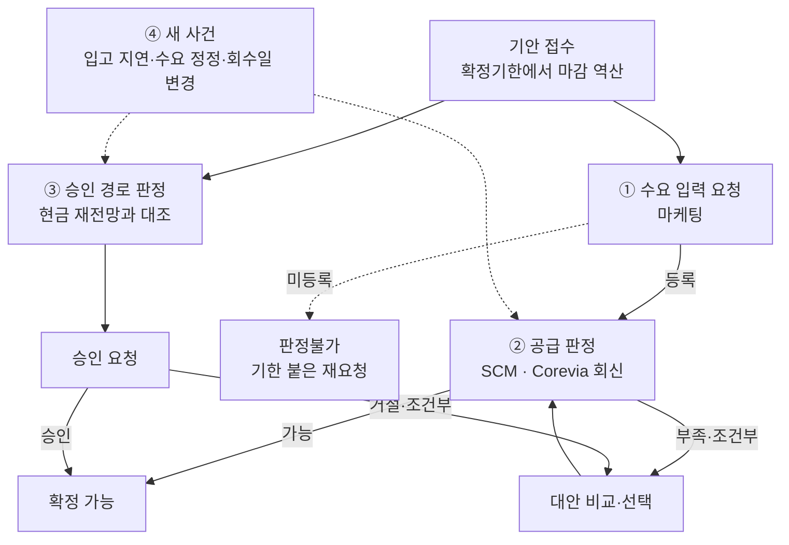

# W01 캠페인 확정 전 점검 시스템

**캠페인 계약이 자동 확정되기 전에, 수요·공급·승인 세 가지 확인이 모두 닫혔는지 기안별로 점검하고 빠진 정보를 담당 부서에 기한과 함께 요청하는 운영 시스템입니다.**

AX 인재전쟁 ONLINE(삼일PwC) W01 과제 "캠페인 수요와 공급 일정"의 풀이입니다.
가상기업 Masil Commerce의 캠페인 확대 기안 25건을, 계약이 자동 확정되기 전에 **확정할지·바꿀지·접을지** 결정하도록 돕는 운영 시스템입니다.

기안마다 **수요 입력 · 공급 판정 · 승인** 세 가지 확인이 모두 닫혀야 "확정 가능"이 되고, 닫히지 않은 확인은 담당 부서에 기한이 붙은 요청으로 나갑니다.

- 실행 환경: Node.js 22.13 이상, 외부 의존성 0개 (`node:http`, `node:sqlite`, `node:test`, 내장 `fetch`)
- 가상 기준일: 2026-07-01, 실행 구간 07-01 ~ 09-14
- 자동 테스트 176개 통과

> 이 저장소의 수치는 모두 대회가 배포한 가상기업 데이터를 다시 계산하거나, 그 위에서 시스템을 실행해 얻은 값입니다. 실제 기업의 운영 성과가 아닙니다.

---

## 1. 문제 정의

### 결정해야 하는 것

캠페인 확대 기안 25건(요청 총액 1.81억 원)의 계약은 확정기한이 지나면 **자동 확정되어 철회할 수 없습니다.** 원본 정책은 이를 묵시적 승인과 같은 효과로 봅니다.

| 확정기한 | 기안 수 |
|---|---|
| 2026-07-17 (기준일로부터 12영업일) | 5건 |
| 2026-08-14 | 12건 |
| 2026-09-11 | 8건 |

그 전에 두 가지를 알아야 합니다. **공급할 수 있는가**, 그리고 **정책이 요구하는 승인 경로를 밟았는가**.

### 원본 데이터에서 발견한 네 가지 문제

네 가지는 하나의 인과 사슬이 아니라 성격이 다른 조건이며, 각각 따로 확인했습니다.

| # | 문제 | 성격 | 원본에서 확인한 사실 |
|---|---|---|---|
| 1 | **수요가 수량·기간으로 주어지지 않는다** | 판단 입력의 공백 | 기안에는 요청액·예상 GMV·집행 예정일·확정기한만 있고 SKU·수량·판매 기간이 없다. 예상 GMV ÷ 요청액은 25건 모두 11.25 / 10.42 / 9.17 중 하나인데, 같은 캠페인의 표본 기준 과거 명목 ROAS는 1.2 ~ 7.7배다. |
| 2 | **기존 수요만으로도 공급 공백이 전망된다** | 운영상 위험 | 더마 3종의 재고 커버는 2.2 ~ 2.9주로 안전재고 4주에 못 미친다. 더마 리드타임은 12주라 기발주분은 9월 중순에야 도착하고, 오늘 추가 발주해도 09-23 도착이다. Corevia 더마 전용 라인(L-02) 가동률은 97%, 주원료는 단일 공급처 독점이다. 실제 입고예정일과 공급 확약은 원본에 없다. |
| 3 | **현금 전망과 승인 경로가 어긋난다** | 정책상 제약 | 정책이 지정한 산식으로 다시 전망하면 07-21 ~ 08-21에 가용현금이 차입 약정 기준 30억 원 아래로 내려간다(최저 17.9억 원). 이 구간에 현금이 나가는 신규 약정은 금액과 무관하게 그룹 CEO 승인 사항인데, 재무팀 공식 전망에는 하회가 없다. |
| 4 | **요청·회신·결정 이력이 없다** | 추적의 공백 | 발주·기안 파일에 승인자, 승인일, 입고예정일, 상태 항목이 없다. 회의록에는 담당과 기한 없이 "승인 주체 미정리"가 미결로 남아 있다. |

### 문제를 보는 기준

W01의 질문은 "어느 부서 사이에서 확인과 결정이 늦어지는가"입니다. 그런데 원본에는 시간 기록이 없어 **누가 얼마나 늦었는지는 입증할 수 없습니다.**

그래서 지연을 걸린 시간이 아니라 **"결정에 필요한 정보가 기한 전에 건네지지 않은 상태"** 로 정의했습니다. 어떤 정보가 비어 있고, 어느 부서가 만들어 어느 부서에 넘겨야 하는지는 원본으로 짚을 수 있기 때문입니다.

| 비어 있는 정보 | 제공 부서 → 받는 부서 |
|---|---|
| SKU별 추가 수요와 판매 기간 | 마케팅 → SCM |
| 입고예정일, 조기·분할·추가 공급 가능 여부 | Corevia → SCM → 마케팅 |
| 정책 방식 현금 재전망과 하회 구간 | 재무 → SCM·마케팅·승인권자 |
| 기한 전 상신 | 기안 부서 → 승인권자 |

입증한 것(무엇이 위험한가)과 입증하지 못한 것(왜 그렇게 됐는가)을 구분했고, 원인을 단정하지 않았습니다. 수익성 판단(실질 공헌이익)과 전속계약 갱신은 범위 밖입니다.

상세: [`notes/01_W01_문제정의.html`](notes/01_W01_문제정의.html)

---

## 2. 해결 방식

문제 네 가지에 구성요소 네 개가 하나씩 대응합니다.



| 문제 | 해결 | 코드 |
|---|---|---|
| 1. 수요 공백 | 담당자가 증가율과 판매 기간을 문장으로 쓰면 AI가 항목으로 정리하고, **담당자가 확인한 값만** 등록한다. 기준 수요(최근 4주 평균)에 증가율을 곱해 SKU·주차별 추가 수량을 계산한다. 입력이 없으면 기본값을 넣지 않고 "판정불가"로 둔다. | `problem1/` |
| 2. 공급 불확실 | 재고와 입고 일정에 추가 수량을 얹어 주차별로 전개하고 **가능 / 조건부 / 부족 / 판정불가**로 판정한다. 부족하면 시기 이동, 물량 축소, 구성 변경, 조기 공급 요청, 보충 발주, 철회를 예상 판정과 함께 비교한다. | `problem2/` |
| 3. 승인 경로 | 정책 순서 그대로 실행한다. 하회 구간 산출 → 약정의 현금 유출일 대조 → 승인권자 지정. 승인 요청 문서는 AI가 초안을 쓰고 담당자가 고쳐 올린다. | `problem3/` |
| 4. 이력 부재 | 모든 요청·회신·판정·결정을 사건으로 남기고, 판정마다 어떤 전제(수요 버전, 입고 일정 버전, 하회 구간 버전) 위에 섰는지 연결한다. 전제가 바뀌면 영향받는 기안의 판정을 다시 연다. | `problem4/`, `app/core/events.mjs` |

### 교육용 흐름에서 바꾼 것

- **순차 → 병행.** 승인 경로 판정을 수요 검토 뒤가 아니라 기안 접수와 동시에 시작한다. 현금 하회는 기발주 대금만으로 성립해 수요를 기다릴 이유가 없다.
- **"보류·재검토" 종료 → 상태.** 보류에는 담당 부서, 재개 기한, 재개 조건이 있어야 한다. 기한이 지나면 자동 확정되므로 보류해도 마감은 멈추지 않는다.
- **발주 승인 ≠ 공급 확약.** 내부 발주 승인과 Corevia의 공급 확약을 따로 관리한다(아래).

### 필수 확장: 내부 승인과 공급 확약의 분리

발주 승인은 Masil 내부의 지출 결정일 뿐, Corevia의 공급 약속이 아닙니다. 공급 회신을 별도 자료로 두고 입고를 **예상 / 확약 / 입고 완료 / 미확약 잔량 / 공급 불가**로 구분했습니다.

- 확약된 입고만으로 버티면 "가능", 예상 입고에 기대면 "조건부". 이 조건은 **승인으로는 풀리지 않는다.**
- 회신에 없는 값은 채우지 않고 "미확인"으로 남긴다. 날짜·수량이 모순되면 "확인 필요".
- 승인권자가 공급 위험을 수용하면 판정은 조건부로 남은 채 "공급 미확약 상태로 확정"으로 기록된다.

처음 구현은 발주안이 승인되면 그 수량을 확정 입고로 등록해, 승인만으로 판정이 "가능"이 됐습니다. 분리한 뒤에는 더마 기안이 발주 승인 후에도 확약이 없어 확정기한까지 조건부로 남습니다.

상세: [`notes/02_W01_해결방식.html`](notes/02_W01_해결방식.html), 각 `problemN/명세.md`

---

## 3. AI 활용

### 시스템 안에서: 읽고 쓰는 자리에만 AI를 둔다

| 주체 | 맡는 일 | 맡지 않는 일 |
|---|---|---|
| **AI (LLM)** | 담당자의 문장을 증가율·시작 주·주수로 정리, 시스템이 계산한 값을 인용한 승인 요청 문서 초안, 사건 영향 요약, 공급처 납기 회신 정리 | 수량·잔액·구간 계산, 판정, 승인 확정 |
| **규칙·계산** | 재고 전개, 현금 재전망, 유출일 대조, 권한 규칙, 상태 전이, 마감 역산 | 원본에 없는 값을 채워 넣는 일 |
| **사람** | 정리된 수요 값의 확인, 대안 선택, 승인 요청의 확인과 상신, 승인·거절·위험 수용, 확정과 철회 | 부서 사이의 대조와 재계산 |

계산과 판정을 규칙에 둔 이유는 **같은 입력에 같은 결과가 나와야 승인 근거가 되기** 때문입니다. AI는 형식이 정해지지 않은 정보를 읽고 쓰는 자리에만 둡니다.

AI 출력에는 세 가지 안전장치가 있습니다.

1. **추측 금지.** 회신에 없는 값은 `null`로 비우고 이유(`unclear_reasons`)를 남긴다.
2. **사람 확인.** 구조화한 값은 담당자가 확인 / 수정 후 확인 / 거부한 뒤에만 반영된다.
3. **호출 기록.** 모든 호출이 모델 이름, 입력 참조, 출력, 검토 결과와 함께 사건 기록에 남는다(`AI_CALL_RECORDED`, `AI_OUTPUT_REVIEWED`).

모의가 아니라 실제 LLM API(OpenRouter)를 호출합니다. 구조화와 글쓰기에 서로 다른 모델을 지정하며, 재현할 수 없는 `openrouter/auto`는 막았습니다. 구현은 [`app/core/ai.mjs`](app/core/ai.mjs)입니다. 키가 없으면 "미연결" 상태로 뜨고, 계산·판정·사건 기록은 AI 없이 그대로 작동합니다.

화면의 **데이터 흐름 창**에서는 담당자의 행동 하나에서 이어진 처리를 사람 / AI / 규칙·계산 / 모의 입력으로 나눠, 사용한 자료와 규칙, 결과를 카드로 확인할 수 있습니다.

### 만드는 과정에서

문제 정의, 원본 데이터 재계산, 명세 작성, 구현, 테스트를 AI 코딩 도구(Claude Code)와 함께 진행했습니다. 작업 순서는 문제 정의 확정 → 해결 방식 → 문제별 명세 → 구현이었고, 제출 답안의 수치는 실제 실행 결과와 대조해 고쳤습니다.

---

## 4. 수치로 본 결과

원본 상태에서는 판단할 수 없던 것이 시스템에서는 어떻게 드러나는지를 비교했습니다. 처리 시간 단축 같은 운영 지표는 원본에 시간 기록이 없어 **측정하지 않았습니다.**

### 원본 상태와 시스템 적용 후

| 항목 | 원본 상태 | 시스템 적용 후 |
|---|---|---|
| 현금 30억 원 하회 구간 | 재무팀 공식 전망: 하회 없음 | 정책 지정 산식 재전망: 07-21 ~ 08-21, 24영업일 하회, 최저 17.86억 원 |
| 그룹 CEO 승인 대상 기안 | 식별되지 않음 (회의록에 "승인 주체 미정리") | 집행 예정일이 하회 구간에 드는 12건 식별. 이 중 3건은 확정기한이 구간보다 먼저 와 기한 전 상신 대상 |
| 기안별 마감 | 확정기한 1개뿐 | 25건 모두 수요 입력·공급 판정·승인 요청·회신 마감을 확정기한에서 역산 |
| 공급 판정 | 판단할 입력 없음 | 수요가 등록된 기안은 SKU·주차 단위로 판정. 없으면 "판정불가"와 요청·기한 생성 |
| 발주 승인의 의미 | 승인 = 입고 확정으로 취급될 수 있음 | 승인과 공급 확약 분리. 확약 없는 더마 기안은 승인 후에도 조건부 |
| 요청·회신·결정 이력 | 0건 | 전부 사건으로 기록, 조건이 바뀌면 영향 기안 재판정 |

### 시나리오 실행 결과 (가상 일자 07-01 ~ 09-14)

| 시나리오 | 결과 |
|---|---|
| **기본** | 25건 중 24건 확정. 수요 회신이 없는 기안은 판정불가로 남아 "담당자 입력 없음" 경위와 함께 기한 경과 확정 |
| **보충 발주의 파급** | 발주가 승인되면 그 지급액이 재전망에 들어가 하회 구간이 08-21 → 08-28로 늘어난다. 집행일이 새 구간에 든 기안 2건의 승인권자가 Masil 대표 → 그룹 CEO로 바뀌고, 이미 올렸던 1건은 다시 상신된다 |
| **회수일 14일 지연** | 하회 구간이 09-04까지 늘어, 승인권자가 그룹 CEO로 바뀌는 기안이 2건 → 5건 |
| **그룹 CEO 현금 조건** (승인 후 최저 잔액 15억 원 이상) | 보충 발주안 3건 거절 → 그 발주에 기대던 기안 3건이 "부족"으로 재판정. 2건은 품목 구성을 바꿔 확정, 1건은 수요 정정 후 확정 |
| **공급 위험 불수용** | 더마 기안 철회, 그 기안만을 위한 발주안 취소로 5.24억 원이 현금 유출에서 빠진다 |

### 검증

- 자동 테스트 176개 통과 (`npm test`)
- 정상, 변경(원료 지연·수요 정정에 따른 재판정), 승인 거절, 정보 부족 사례를 끝까지 실행

---

## 5. 데이터 원칙

- **원본 폴더는 수정하지 않는다.** 추가 자료는 `problemN/data/`에 따로 두고 가상 입력으로 표시한다.
- **합성은 시스템이 받아야 할 외부 입력을 모의하는 데만 쓴다.** 수요 회신, Corevia 공급 회신, SCM 보충 계획, 공급처 결제 조건, 승인 회신이 해당한다. 불리한 경우(입고 지연, 조기 공급 불가, 승인 거절, 회수일 지연)를 반드시 넣었다.
- **근거를 댈 수 없는 수치는 만들지 않는다.** 표본 주문의 전사 환산 계수, 품절 비용, 과거 승인·지연 이력은 만들지 않았다.
- **부서 의견과 사실을 구분한다.** 재무팀 공식 전망은 부서 산출물이라 판정에 쓰지 않고 대조 자료로만 보여 준다. 기안의 예상 GMV는 승인 근거로 쓰지 않는다.

기준: [`context/합성_자료_작성_기준.md`](context/합성_자료_작성_기준.md)

---

## 6. 작동 범위와 한계

| 구분 | 내용 |
|---|---|
| **실제 작동** | 추가 수량 계산, 주차별 재고 전개, 공급 판정, 대안 계산, 보충 발주안 생성·취소, 현금 재전망, 승인권자 판정, 마감 역산과 기한 경고, 재판정, 사건 기록, 공급 회신 검증, AI 호출 |
| **모의 처리** (가상 입력) | Corevia 공급 회신, SCM 보충 계획, 재무 확인, 승인권자의 회신, 날짜 진행, 입고 실적. 회신이 들어온 뒤의 판정·계획·상태 갱신은 구현이 직접 처리한다 |
| **구현하지 않음** | Corevia의 원료·생산 일정 계산, 기준 수요용 정기 발주의 생성과 지급 연결, 실질 공헌이익 산정 |

한계: SCM 정기 보충 발주의 지급은 현금 재전망 기준선에 넣지 않고 민감도로만 보여 줍니다. 승인권자별 결재 소요일은 원본에 없어 가정으로 두었습니다.

---

## 7. 시연 영상

실제 배포본 화면을 조작해 녹화한 시연 영상입니다. 약 4분 23초, 1920×1080, AI 음성 내레이션과 자막이 들어 있습니다.

- 영상: [`outputs/w01-video/W01_시연영상_제출용.mp4`](outputs/w01-video/W01_시연영상_제출용.mp4)
- 녹화 계획·대본: [`notes/04_시연영상_대본.md`](notes/04_시연영상_대본.md)
- 제작 기록과 검수 결과: [`outputs/w01-video/제작_확인사항.md`](outputs/w01-video/제작_확인사항.md)

| 장면 | 내용 |
|---|---|
| 1. 소개 | 업무, 사용자, 돕는 결정 |
| 2. 정상 | PLAN-002를 담당자가 직접 처리. 문장 입력 → AI 정리 → 값 확인·등록(추가 수량 1,404개, 공급 가능) → 그룹 CEO 경로 → AI 초안 확인·상신 → 승인 회신 뒤 확정 |
| 3. 조건 변경 | 보충 발주 승인으로 승인권자가 바뀌고, 원료 지연으로 PLAN-004가 "부족"으로 재판정되어 시기 이동 후 확정 |
| 4. 정보 부족·거절 | PLAN-011(더마): 조기 공급 불가 회신 → 시기 이동 → 조건부 유지 → 위험 수용 후 확정. 그룹 CEO 현금 조건 시나리오에서는 PLAN-014 발주안 거절(14.16억 / 15억) → 구성 변경 후 확정, PLAN-011은 철회되어 5.24억 원 발주안 취소 |
| 5. 필수 확장·다른 부서 영향 | 재무·Corevia 제약이 반영된 위치를 데이터 흐름 카드로 재확인 |
| 6. 추가 확장·한계 | 회수일 지연 비교, 정기 보충 발주 민감도, 직접 처리 기안을 방치했을 때의 기한 경과 경위 |

영상의 시나리오는 초기화로 나눈 별도 실행이며 화면 자막으로 구분했습니다. AI 호출 대기 두 곳과 날짜 진행 대기 한 곳만 8배속이고, 판단 근거 화면은 모두 정속입니다. 다른 부서의 회신과 승인은 모의 입력입니다.

촬영 원본(webm), 음성(wav), 편집 프로젝트(vrew), 중간본 영상은 용량 때문에 저장소에 올리지 않았습니다([`outputs/.gitignore`](outputs/.gitignore)).

## 8. 실행 방법

```bash
npm start        # http://localhost:8080
npm test         # 자동 테스트
npm run reset    # 실행 기록을 비우고 07-01부터 다시 시작
```

| 환경 변수 | 용도 |
|---|---|
| `OPENROUTER_API_KEY` | AI 호출. 없으면 "미연결"로 뜨고 나머지는 그대로 작동 |
| `AI_MODEL_STRUCTURE`, `AI_MODEL_WRITE` | 구조화·글쓰기 모델 지정 (선택) |
| `APP_PASSWORD` | 접속 비밀번호 화면 (선택) |
| `PORT` | 기본 8080 |

Docker로도 실행할 수 있습니다(`Dockerfile`).

## 9. 폴더 구조

```
server.mjs              진입점
app/core/               공통 뼈대: csv, 달력, DB, 가상 시계, 사건, AI, 라우터
app/public/             화면
problem1/               수요 입력과 추가 수량 계산
problem2/               공급 판정, 대안, 보충 발주안
problem3/               현금 재전망, 승인권자 판정, 승인 요청
problem4/               요청·회신·결정 이력, 확정 전 점검, 마감·경고, 재검토
context/                합성 자료 작성 기준
notes/                  작업 문서 (아래 표)
outputs/w01-video/      시연 영상, 자막, 편집·검수 기록
01_참가자_배포용/        대회 원본 데이터 (수정하지 않음)
```

| 문서 | 내용 |
|---|---|
| [`notes/00_대회_숙지_정리.md`](notes/00_대회_숙지_정리.md) | 대회 요건과 평가 기준 정리 |
| [`notes/01_W01_문제정의.html`](notes/01_W01_문제정의.html) | 문제 정의 (사실 / 확인 불가 / 위험 구분) |
| [`notes/02_W01_해결방식.html`](notes/02_W01_해결방식.html) | 해결 방식 설계 |
| [`notes/03_제출답안_초안.md`](notes/03_제출답안_초안.md) | 제출 답안 7개 항목 |
| [`notes/04_시연영상_대본.md`](notes/04_시연영상_대본.md) | 시연 영상 녹화 계획, 대본, 예행 기록 |
| `problemN/명세.md` | 문제별 구현 명세 |

모듈끼리는 사건과 공개 함수로만 연결됩니다. 규칙은 [`app/모듈_계약.md`](app/모듈_계약.md)와 [`problem4/공통_접점.md`](problem4/공통_접점.md)에 있습니다.

대회 폴더 사용 안내(기록 설정 등)는 [`notes/대회_폴더_안내.md`](notes/대회_폴더_안내.md)로 옮겼습니다.
